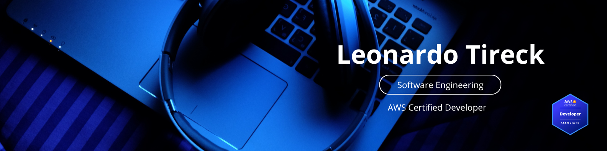

  

<h1 align="center">Hi, I'm Leonardo Tireck 👋</h1>
<h3 align="center">Full-Stack Developer · Backend & Cloud Engineering</h3>

  I build reliable APIs and cloud-native applications with TypeScript, Node.js, and AWS. 
  I care about clean architecture, thoughtful testing, performance, and software that is easy to evolve.

  
  
  

## About me

I'm a Full-Stack Developer at **Coopercompany**, with a strong focus on backend and cloud engineering. My main toolkit is **Node.js, TypeScript, and AWS**, and I also work across the stack when a product needs it.

- ☁️ **AWS Certified Developer – Associate (DVA-C02)** — issued May 2025, valid through May 2028
- 🧱 Trained in **Clean Code & Clean Architecture**, including TDD, DDD, CQRS, Docker, and design patterns
- 🔭 Currently deepening my work with **C#, .NET, data structures, and algorithms**
- 📍 Based in Florianópolis, Brazil
- 🗣️ Portuguese and English

## Engineering toolkit

### Backend & APIs

### Cloud, data & delivery

## What I'm focused on

- Designing secure, maintainable APIs and cloud-native services
- Applying Clean Architecture, SOLID, TDD, and pragmatic design patterns
- Improving delivery through containers, CI/CD, observability, and automation
- Expanding into the .NET ecosystem while continuing to sharpen TypeScript and Node.js

## Selected work

| Project | What it demonstrates | Stack |
| --- | --- | --- |
| [DesignPatterns](https://github.com/LeonardoTireck/DesignPatterns) | Practical GoF and architectural patterns, covered by tests and exercised in PostgreSQL-backed scenarios | TypeScript, Jest, PostgreSQL, Docker |
| [HireMeAPI](https://github.com/LeonardoTireck/HireMeAPI) | Role-based candidate and recruiter API with JWT authentication, validation, security middleware, and relational persistence | TypeScript, Express, Prisma, PostgreSQL |
| [WebAPI](https://github.com/LeonardoTireck/WebAPI) | ASP.NET Core API exploring controllers, dependency injection, repository abstractions, validation, and action filters | C#, .NET 10, ASP.NET Core |
| [DataStructuresAndAlgorithms](https://github.com/LeonardoTireck/DataStructuresAndAlgorithms) | Data-structure implementations and algorithm challenges, including linked lists and binary trees | TypeScript, C# |
| [booknotes](https://github.com/LeonardoTireck/booknotes) | MVC book-review application integrated with the Open Library API and backed by a relational database | Node.js, Express, PostgreSQL |

## GitHub at a glance

  
  

## Let's connect

If you'd like to talk about backend engineering, cloud architecture, APIs, or building dependable software, feel free to reach out on [LinkedIn](https://www.linkedin.com/in/leonardo-tireck/?locale=en_US) or by [email](mailto:leotireck@gmail.com).
